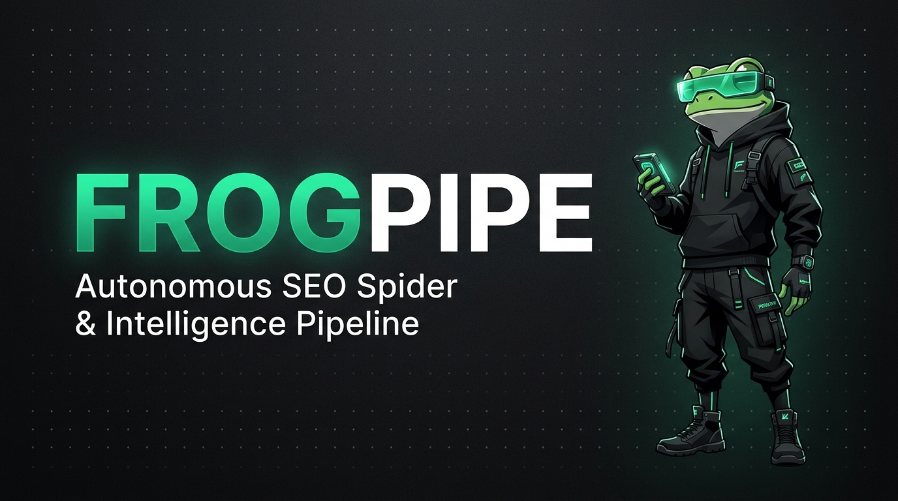

<div align="center">



# 🐸 FrogPipe — Autonomous Screaming Frog SEO Pipeline
### *The Production Headless Crawler, Zero-Loss Dataset Vault & Executive Google Sheets Engine*

[](https://r1fat.pages.dev)
[](https://www.screamingfrog.co.uk)
[](LICENSE)
[](templates/code.gs)
[](requirements.txt)

---

</div>

## 📑 Table of Contents
1. [⚡ Full Setup & Installation Guide](#-full-setup--installation-guide)
   - [System Prerequisites](#1-system-prerequisites)
   - [Step 1: Clone Repository](#2-step-1-clone-repository)
   - [Step 2: Install Python Dependencies](#3-step-2-install-python-dependencies)
   - [Step 3: Link Screaming Frog CLI](#4-step-3-link-screaming-frog-cli)
   - [Step 4: Deploy Google Apps Script Webhook](#5-step-4-deploy-google-apps-script-webhook)
   - [Step 5: Configure Persistent Settings](#6-step-5-configure-persistent-settings)
   - [Step 6: Execute Your First Audit](#7-step-6-execute-your-first-audit)
2. [🏗️ Architectural Pipeline & Mechanics](#️-architectural-pipeline--mechanics)
   - [Phase 1: Headless Spider Execution & Telemetry](#phase-1-headless-spider-execution--telemetry)
   - [Phase 2: Dataset Normalizer & Vault Packaging](#phase-2-dataset-normalizer--vault-packaging)
   - [Phase 3: Offline Master Excel Generation](#phase-3-offline-master-excel-generation)
   - [Phase 4: Google Sheets Live Streaming Sync](#phase-4-google-sheets-live-streaming-sync)
3. [📊 The 11 Core SEO Datasets + Competitors Matrix](#-the-11-core-seo-datasets--competitors-matrix)
4. [🎨 Color Circle Theory Design System](#-color-circle-theory-design-system)
   - [The 8 Chromatic Color Families](#the-8-chromatic-color-families)
   - [Dynamic 2D Badge & Triage Flags](#dynamic-2d-badge--triage-flags)
   - [Competitor Intelligence Benchmark Matrix](#competitor-intelligence-benchmark-matrix)
5. [💻 Command Line Interface (CLI) Reference](#-command-line-interface-cli-reference)
6. [📁 Vault Directory Architecture](#-vault-directory-architecture)
7. [🛡️ Pre-Flight Diagnostics & Disk Space Guard](#️-pre-flight-diagnostics--disk-space-guard)
8. [🔒 License & Intellectual Property](#-license--intellectual-property)

---

## ⚡ Full Setup & Installation Guide

### 1. System Prerequisites
Before running **FrogPipe**, ensure your workstation meets the following requirements:
- **Operating System**: Windows 10/11, macOS, or Linux (hardened for Windows PowerShell / Terminal UTF-8).
- **Python**: Version **3.10** or higher ([python.org](https://www.python.org/downloads/)).
- **Screaming Frog SEO Spider**: Installed on your system ([screamingfrog.co.uk](https://www.screamingfrog.co.uk/seo-spider/)). Free version supports up to 500 URLs; Licensed version supports unlimited crawls.
- **Disk Space**: At least **10 GB of free space** on your system drive (`C:\`). Screaming Frog has an internal safety stop that aborts crawls if free space drops below 5.0 GB.
- **Google Account**: Required for hosting the live executive Google Sheets via Google Apps Script.

---

### 2. Step 1: Clone Repository
Clone the FrogPipe source code into your desired directory:
```bash
git clone https://github.com/expgg/frogpipe-source.git
cd frogpipe-source
```

---

### 3. Step 2: Install Python Dependencies
FrogPipe utilizes `rich` for cyberpunk terminal visuals, `pandas` and `openpyxl` for high-fidelity Excel generation, and `requests` for Google Apps Script webhook streaming.

Install all required packages:
```bash
pip install -r requirements.txt
```
*(Recommended: Use a virtual environment via `python -m venv venv` and activate it before installing).*

---

### 4. Step 3: Link Screaming Frog CLI
FrogPipe requires direct access to `ScreamingFrogSEOSpiderCli.exe`.

The engine automatically scans the following standard installation paths:
1. `X:\APPS\Screaming Frog SEO Spider\ScreamingFrogSEOSpiderCli.exe`
2. `C:\Program Files\Screaming Frog SEO Spider\ScreamingFrogSEOSpiderCli.exe`
3. `C:\Program Files (x86)\Screaming Frog SEO Spider\ScreamingFrogSEOSpiderCli.exe`
4. `D:\APPS\Screaming Frog SEO Spider\ScreamingFrogSEOSpiderCli.exe`

If your installation is in a custom folder, you can either:
- Let FrogPipe prompt you on first run and auto-save the path to `config.json`.
- Or manually set it in `config.json` as shown in [Step 5](#6-step-5-configure-persistent-settings).

---

### 5. Step 4: Deploy Google Apps Script Webhook
FrogPipe can automatically generate a formatted, color-coded Google Sheet for every crawl and provide you with a live shareable URL for clients.

Follow these steps to deploy the backend engine:

1. Open [Google Apps Script Dashboard](https://script.google.com/home).
2. Click **New Project** (top-left button).
3. Rename the project to **`FrogPipe Sheets Engine`**.
4. In the editor, open the default `Code.gs` file and delete any placeholder code.
5. Open [`templates/code.gs`](templates/code.gs) in this repository, copy its entire contents, and paste them into the Google Apps Script editor.
6. Click the **Save** icon (💾) or press `Ctrl + S`.
7. Click the blue **Deploy** button (top-right) and select **New deployment**.
8. Click the gear icon (⚙️) next to *Select type* and choose **Web app**.
9. Configure the deployment settings:
   - **Description**: `FrogPipe Live Sync v4.5`
   - **Execute as**: **`Me (your_email@gmail.com)`** *(CRITICAL: Must be "Me")*
   - **Who has access**: **`Anyone`** *(CRITICAL: Allows FrogPipe to stream datasets securely)*
10. Click **Deploy**.
11. Grant Google permissions if prompted (Click *Advanced* ➔ *Go to FrogPipe Sheets Engine (unsafe)* ➔ *Allow*).
12. Copy the generated **Web App URL** (it ends with `/exec`).

---

### 6. Step 5: Configure Persistent Settings
Create or open `config.json` in the root folder of the project. Paste your Screaming Frog CLI path and the Google Apps Script Webhook URL:

```json
{
  "screaming_frog_cli": "C:\\Program Files\\Screaming Frog SEO Spider\\ScreamingFrogSEOSpiderCli.exe",
  "sheet_webhook_url": "https://script.google.com/macros/s/YOUR_DEPLOYMENT_ID/exec"
}
```
*(Note: If you don't configure `sheet_webhook_url`, FrogPipe will ask you interactively in the terminal or allow you to generate offline Excel files only).*

---

### 7. Step 6: Execute Your First Audit

#### A. Interactive Mode
Simply run the main command:
```bash
python frogpipe.py
```
You will be greeted with the terminal banner:
```text
╔════════════════════════════════════ ⚡ SEO SPIDER AUTOMATION TOOL ⚡ ════════════════════════════════════╗
║    ______ _____   ____   _____ _____ _____ _____  ______                                            ║
║   |  ____|  __ \ / __ \ / ____|  __ \_   _|  __ \|  ____|                                           ║
║   | |__  | |__) | |  | | |  __| |__) || | | |__) | |__                                              ║
║   |  __| |  _  /| |  | | | |_ |  ___/ | | |  ___/|  __|                                             ║
║   | |    | | \ \| |__| | |__| | |    _| |_| |    | |____                                            ║
║   |_|    |_|  \_|\____/ \_____|_|   |_____|_|    |______|                                           ║
║                                                                                                     ║
║  ● ENGINE: Headless Spider   ● DATASETS: 11 Tabs + Matrix   ● FIDELITY: 100% Unpruned   ● LIVE SYNC ║
╚════════════════════════════════════════════════════════════════════════════════ v2.5.0 Production Engine ═╝
```
Enter your target website URL (e.g. `https://r1fat.pages.dev` or `http://drstangale.com`) and hit **Enter**.

#### B. Direct Command Line Mode
Run fully headless crawls by passing flags directly:
```bash
# Basic Audit with live Google Sheets Sync
python frogpipe.py --url https://r1fat.pages.dev

# Offline Mode (Generates CSVs + Excel workbook, skips Google Sheets)
python frogpipe.py --url https://r1fat.pages.dev --no-sheet

# Custom Output Directory
python frogpipe.py --url https://r1fat.pages.dev --output ./client_reports/r1fat

# Verbose Mode (Displays raw Screaming Frog CLI logs)
python frogpipe.py --url https://r1fat.pages.dev --verbose
```

---

## 🏗️ Architectural Pipeline & Mechanics

FrogPipe executes an autonomous 4-phase sequential workflow:

```
[TARGET DOMAIN]
       │
       ▼
 ⚡ PHASE 1: Headless Spider Engine
    - Direct Screaming Frog CLI execution with background trace monitoring
    - Real-time progress bar (Crawled URLs, Queue, Speed, Memory, Disk)
    - Pre-flight disk space health guard & automated instance cleanup
       │
       ▼
 ⚡ PHASE 2: Dataset Normalizer & Vault
    - Normalizes raw crawl exports into the 11 standard SEO audit artifacts
    - 100% Data Fidelity: Zero columns pruned, zero rows dropped
    - Packages all files inside audited_sites/SEO_<clean_domain>/
    - Generates audit_manifest.json with integrity hashes & metrics
       │
       ▼
 ⚡ PHASE 3: Offline Master Excel Workbook (.xlsx)
    - Compiles all 11 tabs + Competitors Analysis Matrix into an offline workbook
    - Color Circle Theory palette with chromatic headers & harmonic lane tinting
    - Cell triage formatting (Status codes, Priorities, Length alerts)
       │
       ▼
 ⚡ PHASE 4: Google Sheets Live Streaming Sync
    - Connects to Google Apps Script Webhook (/exec)
    - Initializes spreadsheet and streams tabs sequentially with live yield logs
    - Applies obsidian master bars, sticky headers, and 2D matrix styling
       │
       ▼
 [DELIVERABLES COMPLETE]
  📁 Local Audit Vault: audited_sites/SEO_<domain>/
  📊 Master Excel Workbook: SEO_Audit_Report_<domain>.xlsx
  🚀 Live Executive Google Sheet: https://docs.google.com/spreadsheets/d/...
```

---

## 📊 The 11 Core SEO Datasets + Competitors Matrix

Every audit produces **11 individual CSV artifacts**, an **Offline Excel Workbook**, and a **Google Spreadsheet** containing all tabs:

| # | Artifact CSV File | Sheet Tab Name | Raw Spider Source | Description & Scope |
|:---:|:---|:---|:---|:---|
| **01** | `1_Issues.csv` | **Issues** | `issues_overview_report.csv` | Complete executive breakdown of all SEO errors, warnings, and opportunities with severity triage. |
| **02** | `2_H1.csv` | **H1** | `h1_all.csv` | All primary H1 heading tags, multiple H1 flags, character lengths, and missing alerts. |
| **03** | `3_H2.csv` | **H2** | `h2_all.csv` | Secondary H2 heading structure, subheading frequency, and content hierarchy. |
| **04** | `4_Meta_Description.csv` | **Meta Description** | `meta_description_all.csv` | Page meta descriptions, character lengths, pixel widths, and SERP snippet previews. |
| **05** | `5_Meta_Tags.csv` | **Meta Tags** | `directives_all.csv` | Meta robots directives, noindex/nofollow flags, canonical tags, and keywords. |
| **06** | `6_Content.csv` | **Content** | `content_all.csv` | Word counts, text-to-HTML ratios, content depth, readability, and thin content warnings. |
| **07** | `7_Page_Titles.csv` | **ALL page Titles** | `page_titles_all.csv` | Complete page title tags, character length optimization (30-60 chars), and pixel widths. |
| **08** | `8_URLs.csv` | **URLs** | `internal_all.csv` | Full index of all crawlable internal URLs, status codes, response times, and hash values. |
| **09** | `9_Images.csv` | **Images** | `images_all.csv` | Comprehensive image audit, missing alt text tags, image dimensions, and payload sizes. |
| **10** | `10_Search_Console_Status.csv`| **Search Console Status** | `search_console_all.csv` / `response_codes_all.csv` | HTTP response codes verification, crawl errors, redirects, and indexability signals. |
| **11** | `11_Canonicals.csv` | **Canonicals** | `canonicals_all.csv` | Canonical link tags, self-canonicalization verification, and canonical mismatch issues. |
| **12** | *Built Dynamically* | **Competitors Analysis** | *Synthesized Matrix* | Executive competitor benchmarking matrix comparing Client domain vs 5 key rivals. |

---

## 🎨 Color Circle Theory Design System

Both the **Google Sheets Engine** (`templates/code.gs`) and the **Excel Master Builder** (`modules/google_sync.py`) implement the **Color Circle Theory (Harmonic Sextant Palette)**. Rather than plain tables or unstyled monochrome text, every column is assigned to a specific chromatic family based on its semantic identity.

### The 8 Chromatic Color Families

1. **Addressing & URLs (Navy Sapphire)**
   - Header: Deep Sapphire Navy (`#1E3A8A`) | Lane Tint: Cool Slate Ice (`#F0F4F8`)
   - Applied to: `Address`, `URL`, `Link`, `Destination`, `Canonical`, `Source`.
2. **Health & Protocols (Forest Emerald)**
   - Header: Deep Forest Emerald (`#064E3B`) | Lane Tint: Soft Mint (`#F0FDF4`)
   - Applied to: `Status Code`, `Response Code`, `Protocol`, `Redirect URI`.
3. **Editorial & Headings (Ocean Teal)**
   - Header: Deep Ocean Teal (`#0F766E`) | Lane Tint: Soft Oceanic (`#F0FDFA`)
   - Applied to: `Title`, `H1`, `H2`, `Heading`, `Snippet`.
4. **Meta Descriptions & SERP (Royal Violet)**
   - Header: Deep Royal Violet (`#581C87`) | Lane Tint: Soft Violet (`#FAF5FF`)
   - Applied to: `Meta Description`, `Description Length`, `Snippet Preview`.
5. **Directives & Indexing (Twilight Indigo)**
   - Header: Deep Twilight Indigo (`#312E81`) | Lane Tint: Soft Indigo (`#EEF2FF`)
   - Applied to: `Indexability`, `Meta Robots`, `Directives`, `Canonical Tag`.
6. **Quantitative Metrics & Depth (Warm Bronze Amber)**
   - Header: Deep Warm Bronze (`#78350F`) | Lane Tint: Soft Parchment (`#FFFBEB`)
   - Applied to: `Length`, `Word Count`, `Width`, `Ratio`, `Size`, `Occurrences`.
7. **Diagnostic Issues & Severity (Ruby Crimson)**
   - Header: Deep Ruby Crimson (`#881337`) | Lane Tint: Soft Rose (`#FFF1F2`)
   - Applied to: `Issue Name`, `Priority`, `Severity`, `Error`, `How to Fix`.
8. **Media & Assets (Raspberry Plum)**
   - Header: Deep Raspberry Plum (`#701A75`) | Lane Tint: Soft Blush Plum (`#FDF2F8`)
   - Applied to: `Image`, `Alt Text`, `Picture`, `Media Dimensions`.

---

### Dynamic 2D Badge & Triage Flags

Cells are conditionally styled based on industry-standard SEO benchmarks:
- **HTTP Status Codes**:
  - `200 / 201`: Mint Green badge (`#D1FAE5` text: `#065F46`).
  - `3xx (Redirects)`: Sky Blue badge (`#DBEAFE` text: `#1E40AF`).
  - `4xx / 5xx (Errors)`: Coral Red badge (`#FEE2E2` text: `#991B1B`).
- **Issues Priority**:
  - `High / Critical`: Bold Crimson alert badge.
  - `Medium / Warning`: Amber alert badge.
  - `Low / Opportunity`: Sky Blue badge.
- **Title Length Optimization**:
  - `30 - 60 chars`: Optimal green badge.
  - `> 60 chars`: Amber badge (Warning: Truncated on Google SERP).
  - `< 30 chars`: Amber badge (Warning: Sub-optimal title depth).
- **Content Word Count**:
  - `< 300 words`: Red badge (Thin content risk).
  - `> 800 words`: Green badge (Comprehensive in-depth content).
- **Missing Elements**:
  - Missing H1, H2, or Image Alt Text: Bold alert rose (`#FFF1F2` text: `#BE123C`).

---

### Competitor Intelligence Benchmark Matrix

The **Competitors Analysis** tab is formatted as an executive dashboard:
- **Row 1**: Dark Warm Obsidian Master Banner (`#1C1917` with Gold `#F59E0B` text).
- **Row 2**: Chromatic Jewel-Tone Column Headers covering:
  - `Website`, `DA` (Domain Authority), `PA` (Page Authority), `SS` (Spam Score), `Ranking Keywords (Moz)`, `DR` (Domain Rating), `Backlinks`, `Linking Websites`, `Website Traffic`, `Traffic Values`.
- **Row 3 (Client Domain)**: Highlighted in radiant **Mint Green VIP Glow** (`#D1FAE5`) with a 2px solid emerald border.
- **Rows 4 to 8 (Rivals)**: Highlighted in soft **Crimson Benchmark Red** (`#FEE2E2`).

---

## 💻 Command Line Interface (CLI) Reference

```text
usage: frogpipe.py [-h] [-u URL] [-o OUTPUT] [-w WEBHOOK] [--no-sheet] [-v] [--keep-temp] [-l LIMIT]

FrogPipe — Autonomous Screaming Frog SEO Audit Engine

options:
  -h, --help            Show this help message and exit.
  -u, --url URL         Target website URL or domain (e.g. r1fat.pages.dev or drstangale.com).
  -o, --output OUTPUT   Custom output directory path (defaults to audited_sites/SEO_<domain>).
  -w, --webhook WEBHOOK Google Apps Script Webhook URL for live Google Sheets publishing.
  --no-sheet            Skip Google Sheets sync (only package CSVs and offline Excel workbook).
  -v, --verbose         Display raw verbose console output from Screaming Frog CLI.
  --keep-temp           Retain raw temporary crawl dumps instead of deleting them.
  -l, --limit LIMIT     Optional limit parameter (note: CLI limits are governed by spider profile).
```

---

## 📁 Vault Directory Architecture

All audit outputs are isolated inside the project root under `audited_sites/`:

```
FrogPipe/
├── audited_sites/
│   └── SEO_pranfoods_net/
│       ├── 1_Issues.csv
│       ├── 2_H1.csv
│       ├── 3_H2.csv
│       ├── 4_Meta_Description.csv
│       ├── 5_Meta_Tags.csv
│       ├── 6_Content.csv
│       ├── 7_Page_Titles.csv
│       ├── 8_URLs.csv
│       ├── 9_Images.csv
│       ├── 10_Search_Console_Status.csv
│       ├── 11_Canonicals.csv
│       ├── SEO_Audit_Report_pranfoods_net.xlsx   <-- Multi-Tab Styled Excel
│       └── audit_manifest.json                  <-- Audit Metadata & Metrics
├── modules/
│   ├── config.py                                <-- Path & setting resolution
│   ├── crawler.py                               <-- Headless CLI driver & trace watcher
│   ├── google_sync.py                           <-- Excel builder & Webhook streamer
│   ├── organizer.py                             <-- Dataset normalizer & packager
│   └── ui.py                                    <-- Cyberpunk Rich terminal visualizer
├── templates/
│   └── code.gs                                  <-- Google Apps Script Live Engine v4.5
├── frogpipe.py                                  <-- Main CLI entry point
├── config.json                                  <-- Saved CLI paths & Webhook URLs
└── requirements.txt                             <-- Python dependencies
```

---

## 🛡️ Pre-Flight Diagnostics & Disk Space Guard

Screaming Frog SEO Spider stores its database instances on the system drive (`~/.ScreamingFrogSEOSpider/ProjectInstanceData/`). If available disk space falls below **5.0 GB**, Screaming Frog aborts immediately.

To prevent crawl failures:
1. **Automated Disk Check**: Before initiating any crawl, FrogPipe inspects the system drive.
2. **Orphaned Cache Sweep**: If free disk space is under **6.0 GB**, FrogPipe automatically detects and purges abandoned Derby database folders from interrupted crawls.
3. **Trace Log Error Extraction**: If Screaming Frog ever exits unexpectedly, FrogPipe reads the tail of `trace.txt` and displays the exact root cause in plain English directly in the console.

---

## 🔒 License & Intellectual Property

**COPYRIGHT (C) 2026 AL HOSSAIN RIFAT. ALL RIGHTS RESERVED.**

This software is strictly proprietary and confidential. No part of this codebase may be copied, modified, redistributed, forked, sublicensed, or used for commercial purposes without explicit, written permission executed directly by the author.

For enterprise licensing, architectural inquiries, or custom tool development:
- 🌐 **Portfolio & Contact**: [r1fat.pages.dev](https://r1fat.pages.dev)
- 💼 **Author**: Al Hossain Rifat
- ⚡ **Version**: `FrogPipe Production Engine v2.5.0`
